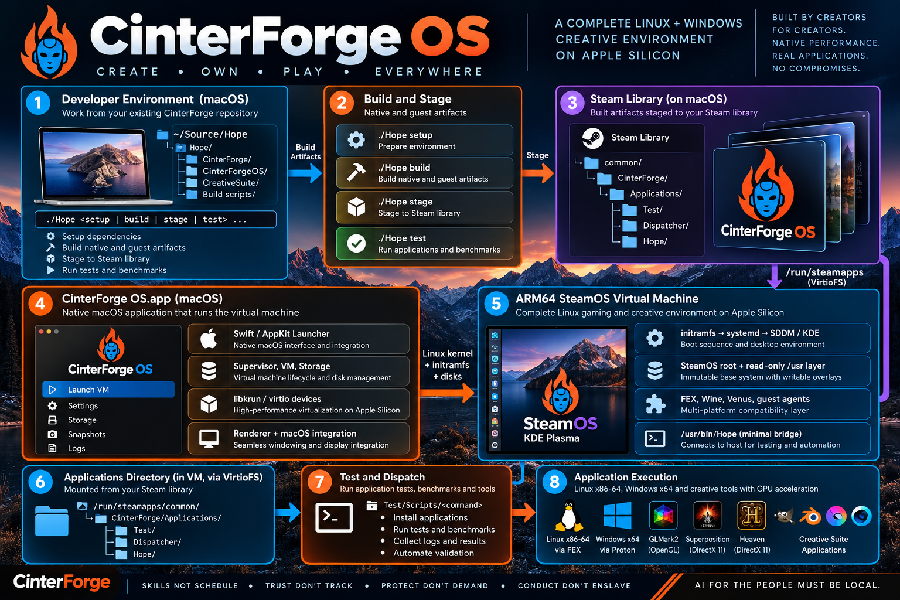

# CinterForgeOS Architecture

**Engineering orientation · updated 24 October 2026**  
**Audience:** engineers encountering this repository for the first time.  
**Basis:** the supplied `technical/` documentation, cross-checked against the current CinterForgeOS source snapshot available for this review. This is an architectural source walkthrough, **not** a claim that the complete system has been rebuilt or runtime-tested here.

## 1. What CinterForgeOS is

CinterForgeOS is a native **Apple Silicon macOS application** that hosts an **ARM64 SteamOS** environment in a libkrun virtual machine, presents that environment through a native macOS window, and exposes a **KDE Plasma desktop** where Creative Suite applications can be launched and tested. It is not a macOS port of KDE, a conventional Ubuntu desktop VM, or a web/HTML replacement desktop. The operating system inside the VM is distinct from the installed Creative Suite applications and their mutable tooling.

Think of the system as four cooperating layers:

1. **Host application (macOS):** a signed `.app` with Swift/AppKit, libkrun, graphics, networking, input, sound, lifecycle management and disk creation.
2. **Guest OS (ARM64 Linux/SteamOS):** kernel, initramfs, SteamOS partitions, read-only integration layer, systemd, KDE/SDDM, graphics and compatibility services.
3. **Persistent Steam library:** a host-owned `steamapps` tree exposed read/write to the guest as **one** VirtioFS share at `/run/steamapps`. Installed applications, mutable scripts, logs and test artifacts live here.
4. **Hope / CinterForge lifecycle:** the developer-facing Build → Stage → Test operations and the external guest command dispatcher. OS-internal startup code establishes the environment; **operational commands execute outside the guest OS image**.

These layers have separate responsibilities and different update costs. A baseline collector fix is not a reason to rebuild SteamOS; a kernel or early-boot change is.

## 2. System-level diagram



**Critical distinction:** `Hope` inside Konsole is *not* the macOS `./Hope` launcher. They present a consistent command interface in their respective environments. The guest `/usr/bin/Hope` is a small forwarding bridge, not an embedded test framework.

## 3. Repository map and ownership

| Location | Purpose | Runtime/build role |
|---|---|---|
| `source/Swift Source/Core/` | Native app entry, options, VM configuration, supervisor, console | Host application startup and every VM boot |
| `source/Swift Source/Interface/` | AppKit windows, settings, overlays, progress and presentation UI | Native launcher UI |
| `source/Swift Source/Graphics/` | Display backend, renderer, presenter, EDID, Metal-related support | Frame rendering and resizing |
| `source/Swift Source/Input/` | Keyboard, pointer/tablet, controller, clipboard, audio controls | Runtime host/guest device integration |
| `source/Swift Source/Networking/` | gvproxy/networking, Remote Play relay | VM network startup and optional streaming |
| `source/Swift Source/Storage/` | Disk creation, GPT, provisioning, disk locking/growth and update bundles | First run and disk lifecycle |
| `source/Swift Source/Updates/` | Suspend and update checks | Host application lifecycle |
| `source/Swift Source/Diagnostics/`, `Tests/` | Reports/crashes and host self-tests | Diagnostics/developer checks |
| `source/CKrun/`, `source/CZstd/` | Native library bindings/support | Xcode compilation/link |
| `host/libkrun/`, `host/virglrenderer/`, `host/moltenvk/`, `host/kosmickrisp/`, `host/libepoxy/` | Patched host-native virtualization/graphics dependencies | Built as host prerequisites; libraries staged into app |
| `guest/kernel/` | ARM64 kernel and build inputs | Guest image build, then every boot |
| `guest/initramfs/` | Early userspace and boot/provision logic | PID 1 before systemd |
| `guest/layer/` | OS integration overlay: units, helpers, KDE entries, guest Hope bridge | Image build; applied to guest `/usr` |
| `guest/mesa/` | Guest Vulkan/Mesa Venus variants | Graphics build and runtime |
| `guest/fex/` | x86-64 compatibility runtime/user-space acquisition | Guest compatibility image inputs |
| `guest/progress-agent/` | Rust guest/host progress and control agent | Image build; guest services at runtime |
| `scripts/steps/`, `scripts/build-image.sh` | Existing guest image construction | Native Xcode build delegates Linux work here |
| `scripts/guest-artifacts.py` | Guest artifact receipts and input/output verification | Build cache/verification |
| `CinterForgeOS.xcodeproj/` | **Authoritative native macOS application target** and build phase order | Xcode Build |
| `resources/` | App icons, splash, plist and entitlements/resources | Xcode bundle resources |
| `docs/technical/` | In-depth component-specific explanation | Engineer reference |

**Legacy warning:** some supplied technical documents and README passages describe `host/launcher/` as a Swift Package application. The user has explicitly retired that launcher. **Use `source/Swift Source/` plus current Xcode project membership as the active native launcher**, not an old SwiftPM build recipe. The inspected source snapshot still included `host/launcher/`; its mere presence must not be interpreted as an active production entry point. Do not recreate it.

## 4. The macOS launcher: process and object lifecycles

### 4.1 Native entry point and UI

`source/Swift Source/Core/main.swift` is the native app entry and contains the application lifecycle glue. The app resolves launch options and saved settings, constructs a native UI when not headless, and coordinates window and VM state. The interface is implemented in the `Interface/` folder, with graphics presentation in `Graphics/`; the host is a native application, not a web view around a Linux process.

`Core/Options.swift` is the useful starting point for understanding configuration, image paths and launch flags; `Core/AppBundle.swift` resolves bundle-related concerns. The macOS app's runtime resources are distinct from the host's working Build outputs.

### 4.2 Why there is a supervisor process

`Core/Supervisor.swift` documents an important libkrun behavior: **libkrun may terminate the VM-hosting process using `_exit()` when the guest powers off or reboots**. Therefore a **parent supervisor** stays alive and starts a separate **VM child process** for each boot. The source uses `STEAMAC_VM_CHILD`, `STEAMAC_RUN_DIR`, `STEAMAC_NET_SOCK`, and boot/frame environment variables to distinguish and coordinate these processes.

The supervisor owns lifecycle concerns that must survive a VM child exit: per-boot gvproxy startup, signal forwarding, temporary run-directory cleanup, terminal restoration, and deciding whether to relaunch after the guest requests reboot. Its `run()` loop resolves options again on each boot, checks exclusive access to writable disks and applies pending disk growth. A reboot is not just an AppKit window redraw: it tears down and recreates the VM child while retaining the supervising host process.

### 4.3 VM construction and devices

`Core/VM.swift` creates and configures the libkrun context. The visible sequence includes:

1. Raise the file descriptor limit; initialize libkrun logging; create the VM context and configure CPU count/memory.
2. Disable implicit vsock/console; configure a deliberate multiport virtio console, including a PTY for the guest console.
3. Attach explicitly named virtio ports for progress, clock updates, sleep, controller input/rumble and clipboard when configured.
4. Set the ARM64 kernel, initramfs and kernel command line; attach guest block disks, locking writable disk access.
5. Resolve the **one Steam library** and export it read/write as tag `steamapps` through `krun_add_virtiofs4`, using `KRUN_SEMANTICS_LINUX_SIMPLIFIED` to reconcile guest ownership with the host Steam library.
6. Configure sound, GPU/display capabilities, backend and host input/display handling; start the VM via `krun_start_enter`.

This is a *device and boot configuration layer*. It does not run application installers or baseline collection scripts.

### 4.4 Host resource and disk path selection

The current `VM.swift` derives the Steam library from a managed writable SteamOS disk under `Applications/macOS/CinterForgeOS/<version>/SteamOS/steamos.img` or from the correctly installed app path. Development overrides (`CINTER_STEAM_APPS_ROOT`, `CINTER_DEV_APPLICATIONS_DIR`) exist, but a mismatched override is an error, not a reason to mount some unrelated user library. It validates that the selected path is a `steamapps` directory containing `common/CinterForge/Applications`.

The app keeps the SteamOS virtual disk separate from installed apps so replacing the signed launcher or refreshing an installed app version does not inherently erase guest state. `Storage/DiskLock.swift`, `DiskCreator.swift`, `Provision.swift`, `DiskGrower.swift`, `GPT.swift` and related files form the first-run/persistent-disk subsystem. For partition creation and initial provisioning consult the storage sources and companion **CinterForgeOS guest.md**, rather than treating the disk as an opaque file.

### 4.5 Host devices, network and graphics

The host uses a patched libkrun and a GPU pipeline that bridges guest Vulkan through Venus/virtio-gpu and virglrenderer to a host Vulkan implementation on top of Metal. The project retains **MoltenVK** and **KosmicKrisp** host backends; they are specialized source/patch trees, not generic interchangeable Homebrew packages. The presenter/renderer translates the guest display into the native macOS window; EDID sizing and resize behavior span `Graphics/` and `Core/VM.swift`.

The host supplies input through `Input/` (keyboard/pointer/tablet, GameController gamepads/HID, rumble), sound integration, bidirectional clipboard and `Networking/Network.swift`/gvproxy. Guest-side agents and systemd services are the receiving counterparts. Remote Play support lives in networking/UI paths and should not be conflated with the fundamental VM network link.

## 5. The SteamOS guest: boot and desktop lifecycle

The guest is not launched by `ssh`ing into another OS. It boots as a separate ARM64 Linux machine:

**Kernel → initramfs PID 1 → filesystem assembly → systemd → SDDM/KDE → interactive desktop.**

`guest/initramfs/init` finds the expected disk partitions, manages Valve-style A/B boot state and attempt bookkeeping, and assembles filesystem mounts before handing off to systemd. Guest additions are carried in a separately built, read-only EROFS integration layer applied above the underlying SteamOS `/usr` rather than by casually mutating Valve's rootfs. That separation helps preserve base SteamOS and its update/rollback model.

`guest/layer/usr/` includes system units and desktop files, SteamOS compatibility helpers, KDE configuration and `/usr/bin/Hope`. Early mount configuration includes the **VirtioFS `steamapps` share**: host tag `steamapps`, guest location `/run/steamapps`, read/write. A missing mount is a host/guest contract failure, not a request to introduce additional parallel shared folders.

Some guest helpers properly remain internal: filesystem initialization/verification, systemd and SDDM/KDE startup, compatibility code that runs before the share exists, Steam client/session integration and update safety hooks. **Day-to-day installer and testing algorithms do not belong in the guest image.** See **CinterForgeOS guest.md** for the exact guest directory and unit inventory.

## 6. Hope: the operational boundary

Hope is the single public interface for developers and the guest desktop:

- From the **macOS Hope repository root**, use `./Hope ...` for lifecycle operations.
- From **Konsole's default prompt**, use `Hope ...` for guest operations.

The checked-in guest `/usr/bin/Hope` bridge is intentionally tiny: it validates that `/run/steamapps/common/CinterForge/Applications/Test/Dispatcher/Hope` exists/readable and then executes `/bin/sh "$dispatcher" "$@"`. It does **not** implement command-specific logic or import Python modules such as `filesystem_inventory`.

The external dispatcher routes command names to persistent implementations under `Applications/Test/Scripts/`. This allows scripts such as baseline generation, FEX/Wine inspection, installers, diagnostic utilities and application launch commands to be edited in the **CinterForge** source and deployed by the **existing Hope Stage**, rather than rebuilt into the guest. Individual applications retain their own persistent installed versions, test programs and test results.

**Ownership rule:** internal scripts must be justified by boot, essential device/mount initialization or OS session operation. An implementation that can run once `/run/steamapps` is mounted should generally be external. Changing an external script should not require Xcode, an OS image rebuild, a guest reboot or a separate activation script.

## 7. Application and compatibility execution paths

A KDE launcher is primarily a *declarative UI entry*. For example, source entries use `Exec=Hope launch-cinterforge Linux Krita` or `Exec=konsole --hold -e Hope install-unforked Windows Krita`. Their substantial implementation must reside in externally staged command scripts; `.desktop` definitions themselves are OS UI assets and can be part of the read-only layer.

There are distinct execution environments:

- **Native SteamOS/KDE (ARM64):** desktop shell and host/guest integration.
- **Linux x86-64 through FEX:** executes compatible Linux AMD64 programs using an x86-64 userspace/rootfs; graphics libraries and the FEX translation layer serve different functions.
- **Windows applications through Wine/Proton-related compatibility paths:** Windows runtime components and graphics translation are layered over the guest/FEX machinery as appropriate.
- **Separate Ubuntu 24.04 AMD64 headless environment:** a development build/test userspace, *not* a second graphical Ubuntu desktop in the CFOS VM.

The current guest image tooling packages selected FEX and Wine runtime binaries/rootfs under `/usr/share/cinterforge/fex/`; do not confuse **external operational scripts** with **image-baked compatibility binaries**. Updating an externally staged launcher does not automatically replace image-baked FEX components.

## 8. Linux AMD64, FEX graphics, and Windows Proton: current integration

### Execution boundaries

The KDE guest is **ARM64 SteamOS**, while `FEXBash` executes Linux **x86-64** binaries using a separate Debian 13 (Trixie) rootfs. The rootfs is an image-baked compatibility userspace under `/usr/share/cinterforge/fex/RootFS`, not a writable Ubuntu GUI VM. Do not infer an executable's architecture from `uname -m` inside `FEXBash`: PATH can still find a **native ARM64** SteamOS utility. Resolve and inspect the actual ELF with `file` or `readelf` before treating graphics-test results as AMD64 results. The separate Ubuntu 24.04 AMD64 environment remains **headless**, for build/test work only.

Windows graphical execution has been demonstrated with the guest's **Proton 11.0 (ARM64)** runtime: Windows Notepad displayed in KDE, and `cmd.exe` successfully wrote a file in its compatibility prefix. This is evidence of Windows GUI/execution, **not** evidence that DXVK/DirectX 11 accelerated gaming or the Heaven benchmark works. A standalone Wine 11.19 AMD64 runtime previously failed even for `cmd.exe` with `kernel32.dll`/`c0000135`; do not conflate the two runners. Installed applications belong under persistent `Applications/Windows/<app>/<version>/`, outside disposable prefixes where possible.

### Shared FEX Setup/Build preparation (source implementation)

The current source incorporates incremental FEX graphics preparation; whether the newly configured thunk-enabled build succeeds and runs on the actual VM is **not yet verified**:

| Source path | Present implementation / contract |
|---|---|
| `guest/fex/Dockerfile` | Debian Trixie ARM64 build-toolchain dependencies, including `llvm-19-dev`, cross-compilers and OpenGL/Vulkan development libraries. This is a **build** container, not guest package installation. |
| `guest/fex/build.sh` | Build pinned FEX with `-DBUILD_THUNKS=ON`; install to a fresh staging directory and check for `libGL-host.so` and `libvulkan-host.so` under `usr/lib/aarch64-linux-gnu/fex-emu/HostThunks` (AArch64), and `libGL-guest.so` and `libvulkan-guest.so` under `usr/share/fex-emu/GuestThunks` (x86-64); promote only validated output. These paths/checks reflect the **current source contract**, not a confirmed successful upstream build. |
| `guest/fex/runtime.sh` | Builds the Debian AMD64 rootfs in an AMD64 Docker environment, including `libsm6`, `libice6`, X11/XCB, Mesa GL/Vulkan drivers, and architecture-specific `glxinfo`/`vulkaninfo`. Produces a packaged userspace without relying on DNS inside the running guest. |
| `scripts/build-image.sh` | Before reusing cached guest compatibility inputs, checks for complete FEX host/guest graphics libraries and required AMD64 rootfs content; triggers the existing rebuild steps when incomplete. |
| `scripts/steps/30-layer.sh` | Copies FEX binaries and rootfs into the read-only OS layer, checks thunk presence/ELF architectures, writes a FEX config pointing to the embedded rootfs and enabling GL/Vulkan thunk entries. |

**Setup/readiness rule:** FEX bootstrap preparation is **build-time** work orchestrated through the existing guest image pipeline and Xcode. The VM should not `apt install` libraries on every boot. Application-specific pinned libraries remain in each application's persistent install when necessary; common AMD64 GUI dependencies belong in the shared prepared rootfs. `ThunksDB.json` alone describes potential overlays and does not prove functioning guest/host thunk binaries. A successful CMake configure, package extraction, or presence check does not establish graphics or desktop readiness.

### Observed graphical benchmark evidence (24 October 2026)

| Workload / check | Observed result | Meaning |
|---|---|---|
| Native ARM64 `vulkaninfo --summary` | Detects `Virtio-GPU Venus (Apple M4 Max)` and Mesa Venus; Vulkan API 1.4 reported | Native GPU discovery works; rendering throughput not proved. |
| Actual AMD64 GLMark2 via FEX | Windowed 3D scene rendered; `GL_RENDERER: llvmpipe (LLVM 19.1.7, 256 bits)`; Mesa 25.0.7; OpenGL 4.3 compatibility | Verified **software** 3D, **not** Apple GPU acceleration. |
| AMD64 Superposition 1.1 | 2.8 GB extracted to `Applications/Linux/Superposition/2026/`; Qt initially failed on `libSM.so.6`, corrected by extracting Debian `libsm6` / `libice6` into app-local `Dependencies/` | Illustrates why GUI libraries must be prepared in the common rootfs. |
| Superposition launch | Qt/XCB and QML plugins loaded and a black KDE window appeared; normal hardware path logged `failed to create dri3 screen` and `failed to load driver: virtio_gpu` | Window creation established; benchmark rendering **not** established. |
| Superposition forced llvmpipe | Segmentation fault, exit code 139 | Crash remains unlocated; no basis to ascribe it solely to driver or FEX. |
| `glxinfo` invoked by name inside FEX | Resolved to native ARM64 `/usr/bin/glxinfo`, not AMD64; GLX context creation failed | Not a valid diagnostic of the x86-64 GLX path. |
| AMD64 Vulkan in previous installed rootfs | Loader found, but the inspected AMD64 ICD config and driver were absent | Incomplete earlier image; current source now prepares Mesa Vulkan ICDs, **not yet verified in rebuilt guest**. |
| Windows Heaven / Proton | Installer acquired; no confirmed Heaven benchmark rendering or score | Pending acceptance test. |

The existing installed FEX runtime showed `/usr/bin/FEX` and a `ThunksDB.json` mapping `GL` and `Vulkan`, but searches did not find `libGL-guest.so` / `libvulkan-guest.so` or matching host libraries. That is evidence of an **incomplete or not-yet-discovered** graphics-forwarding installation, not proof of a functional hardware bridge. The source changes described above aim to fail early on missing components; **the complete Xcode/FEX rebuild and hardware test are still pending**. A recent Xcode build reported missing `libGL-host.so`; a subsequent build exposed an LLVM 19 CMake configuration prerequisite, motivating the `llvm-19-dev` addition. No successful end-to-end build is claimed here.

### Graphics acceleration contract

```text
Linux x86-64 Superposition / GLMark2
  -> FEX AMD64 guest execution + GL/Vulkan forwarding (target; unverified)
  -> native ARM64 Venus -> Virtio-GPU -> macOS host graphics / Apple GPU

Windows x64 Heaven
  -> Proton 11 ARM64 / Windows compatibility + DXVK (target; unverified)
  -> native Vulkan Venus -> Virtio-GPU -> macOS host graphics / Apple GPU
```

Treat Vulkan device *enumeration*, OpenGL *software rendering*, Qt *window creation*, and *hardware GPU rendering* as **four different tests**. Hardware-ready status requires a real AMD64 graphics workload that identifies a non-llvmpipe accelerated renderer and successfully draws frames; Heaven requires a real DirectX benchmark run. These requirements apply to the shared Linux environment and tests, not to one-off Superposition launch hacks.

## 9. Build, Stage, Test: different owners and guarantees

**Native Build:** The current Xcode `CinterForgeOS` scheme compiles and signs the native macOS application. Its project declares shell phases for host tools/libraries and Linux guest kernel/initramfs/Mesa/layer construction. Those phases call the **existing** `scripts/` tooling; Xcode is the orchestrator, not the Linux compiler for guest code. `CZstd` is a local target and Sentry is an additional package dependency described in the project documentation.

**Guest artifact build:** `scripts/build-image.sh` calls existing steps for builder, rootfs, initramfs, FEX/userspace, layer, disk and checks; `scripts/steps/30-layer.sh` installs the declared guest `usr/` inputs and creates an EROFS layer. The layer builder is correct to install the files it is handed: **remove inappropriate operational sources from guest image inputs rather than inventing another image-install mechanism**. `scripts/guest-artifacts.py` verifies/caches some outputs through input/output receipts; a verified receipt is not proof that Xcode built everything in the current invocation.

**Stage:** From the Hope root, `./Hope stage cinterforge-os mac Release` consumes the Xcode-built native application and uses Hope's established lifecycle to install it and provision/update the external dispatcher and scripts under persistent `steamapps`. **Stage should not modify the signed `.app`** or rebuild the OS merely to refresh external tools. It preserves persistent SteamOS state and application versions according to the existing installation layout. The supplied logs from this conversation demonstrate successful Stage installs and one migration of a retired dispatcher; a successful Stage log is not by itself a guest runtime test.

**Test:** On the macOS side, `./Hope test ...` follows the Creative Suite test lifecycle. Inside the guest, `Hope ...` runs the external command scripts and per-app test logic from their persistent homes. There is **no separate ad-hoc activation/staging path**.

### Update-cost table

| Change | Correct route | Requires guest image rebuild? |
|---|---|---|
| Baseline logic / Python inventory / installer diagnostics | Modify CinterForge external source; Hope Stage | **No** |
| External dispatcher / app launch command | Modify CinterForge external source; Hope Stage | **No** |
| Installed app version or its local tests | Existing app Build/Stage/Test | Normally **no** |
| macOS Swift VM or AppKit behavior | Xcode native Build, then Hope Stage | Not inherently, unless guest contract changes |
| Kernel, initramfs, image-baked services, KDE `.desktop` entries, guest graphics runtime | Existing guest image Build, then Stage | **Yes**, for changed image content |
| Host Vulkan/libkrun binary changes | Rebuild/sign native dependencies/app, then Stage | Not inherently |

## 10. Host/guest contracts to preserve

| Contract | Owner and check |
|---|---|
| **Single share:** host Steam library → virtiofs tag `steamapps` → `/run/steamapps` | `Core/VM.swift` and guest mount units must agree |
| **Guest command bridge:** `/usr/bin/Hope` → persistent dispatcher | Guest bridge remains generic; Stage supplies dispatcher |
| **External commands:** dispatcher → persistent `Test/Scripts/` | CinterForge source owns implementations, not `guest/layer` |
| **Disk preservation:** mutable guest disk separate from signed app | `Storage/`, supervisor and Hope Stage |
| **Guest boot assets:** kernel + initramfs + disk + EROFS layer | Xcode's artifact phases and guest image scripts |
| **Virtio communication:** named ports for progress, clock, sleep, pad, clipboard | `Core/VM.swift` + guest `fx-progress-agent` services |
| **Graphics:** Venus/virglrenderer and selected host Vulkan-on-Metal stack | Guest Mesa and patched host graphic dependency sources |

Avoid reintroducing old `/run/Applications` or `/run/DeveloperTests` mounts. Do not introduce additional guest-side test scripts or alternate Stage wrappers as a workaround for a missing external script.

## 11. Troubleshooting by symptom

| Symptom | Inspect first | Common boundary involved |
|---|---|---|
| App will not start at all | `Core/main.swift`, `Core/Supervisor.swift`, AppBundle, native framework/signing logs | macOS app / native dependencies |
| VM exits or reboots unexpectedly | supervisor child exit/reboot marker; `Core/VM.swift`; kernel/initramfs console | host VM lifecycle / guest boot |
| KDE does not appear | guest systemd/SDDM units, session helper scripts, progress agent | guest startup |
| `/run/steamapps` absent or not writable | host `krun_add_virtiofs4` selection/semantics; guest mount unit | single-share contract |
| `Hope baseline all` calls `/usr/lib/cinterforge/...` | installed external `Test/Dispatcher/Hope`, **not** Xcode | stale external dispatcher |
| Python helper import fails after dispatch | external `Test/Scripts` deployment and import path | external script packaging |
| x86-64 Linux app fails | FEX and x86-64 rootfs; external runtime command | compatibility userspace |
| Windows app fails | Wine prefix/runtime; external installer/inspection command | Windows compatibility |
| Vulkan game launches but graphics fail | guest Venus, virglrenderer, MoltenVK/KosmicKrisp, GPU logs | GPU pipeline |
| Stage succeeds but new external command unavailable | staged script list, external dispatcher, persistent Steam library | lifecycle delivery, not OS boot |

## 12. How a visiting engineer should work

Start by deciding which side owns the behavior. To understand **guest boot**, read **CinterForgeOS guest.md**, `guest/initramfs/init`, the units in `guest/layer` and `scripts/steps/30-layer.sh`. To understand **host internals**, read **CinterForgeOS host.md**, `Core/VM.swift`, `Core/Supervisor.swift`, `Core/main.swift` and the graphics/network/device modules. For **Xcode phases and build products**, read **CinterForgeOS XCode Project.md** and the **actual** `project.pbxproj`; source documents sometimes describe earlier arrangements. The extensive **Steamac README.md** is valuable for ancestry, technical details and graphics patches, but some paths and workflows are historical.

For ordinary project operations use the existing Hope interfaces, from their default working directories. A code change should be local to its owner, preserve the guest/host contract, and produce a changed-files-only patch. Do not “fix” a missing external operational script by embedding it in the OS. Do not make the developer rebuild the VM to iterate on a test algorithm.

## 13. Verified scope, historical material, and open questions

The following points are **directly visible in the inspected source**: the Xcode target's declared build phases; the supervisor/VM child separation; the `steamapps` share in the active `source/Swift Source/Core/VM.swift`; the minimal `/usr/bin/Hope` forwarding implementation; the guest layer construction scripts; and the guest directory ownership boundaries. The source also shows legacy host launcher content remaining in the examined snapshot; the user has declared it retired. This document treats the **Xcode Swift tree as authoritative**.

The attached documents differ in age and sometimes in stated phase order. In particular **CinterForgeOS XCode Project.md** identifies several guest artifact phases, while a short introductory section describes only one retained application script phase. The *checked-in Xcode project* is the authority for the actual native build graph. Do not use an older narrative statement to delete active phases.

A few end-to-end claims require verification on the engineer's machine: whether every guest image output in a particular Xcode invocation was newly built versus cache-validated; which exact guest update slot is active; whether every desktop shortcut works; and whether each installed external script actually executes successfully. These are **verification tasks**, not excuses to change the architecture.

---

### Companion reading

- **CinterForgeOS guest.md** — guest filesystem layout, boot phases, OS-essential helpers and shared filesystem contract.
- **CinterForgeOS host.md** — native host components, patched libraries, I/O and source ownership.
- **CinterForgeOS XCode Project.md** — targets, shell phases, generated products and Xcode integration.
- **Steamac README.md** — detailed upstream-derived implementation notes and component background; treat historical `host/launcher` instructions as legacy.
