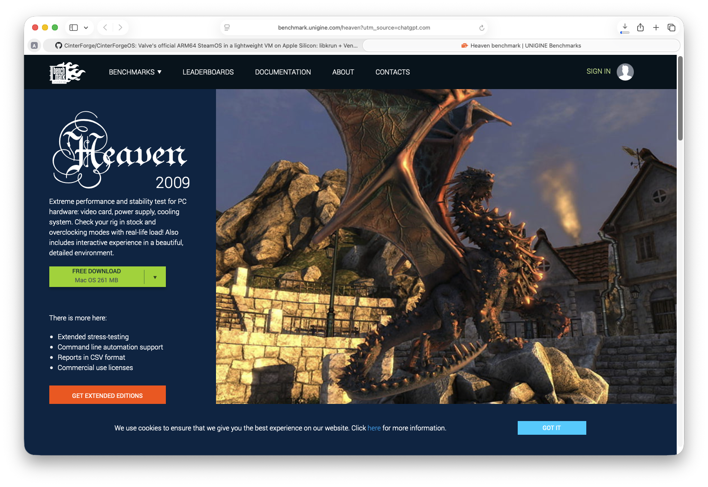
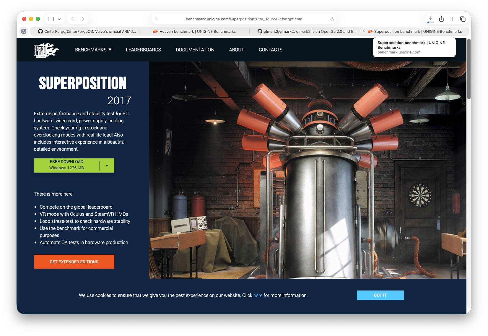

# CinterForgeOS — Cross-Platform Graphics Benchmarking

**One Apple Silicon Mac. One SteamOS desktop. Two x86-64 application ecosystems.**

CinterForgeOS is built to make running and debugging Linux and Windows software on a Mac feel like a natural part of development. Our graphics showcase brings that ambition into focus with two recognizable, visually rich benchmarks: **UNIGINE Heaven 4.0 for Linux x86-64 (working)** and **UNIGINE Heaven 4.0 for Windows through Proton**. UNIGINE Superposition remains a separate Linux target requiring OpenGL 4.5.

The aim is more than a screenshot. We want repeatable evidence that the application is an x86-64 binary, that its compatibility runtime is working, that a real scene renders in KDE, and—separately—that rendering is **GPU-accelerated** rather than CPU-only.

## Two worlds, one desktop



Heaven is the Windows showcase running through **Proton 11 ARM64 / Wine / FEX** in the same KDE desktop. Its launcher works, and selecting Run creates a benchmark window and `heaven.exe` process, but the engine exits while the launcher remains alive. No stable Windows rendering or benchmark score is established.

- **Publisher:** [UNIGINE — Heaven](https://benchmark.unigine.com/heaven)
- **Application:** Windows x64 edition (verify the executable is PE x64)
- **Execution:** Apple Silicon macOS → CinterForgeOS ARM64 SteamOS → Proton 11 ARM64 → Windows application → KDE window
- **Graphics target:** DirectX 11 translated through DXVK/Vulkan where supported; identify the actual Vulkan device
- **Install destination:** persistent `Applications/Windows/Heaven/<version>/` with isolated Proton compatibility data

### Windows x64 — UNIGINE Heaven


**Actual capture from CinterForgeOS, October 25, 2026.** The on-screen benchmark HUD shows **131 FPS** at the captured instant, with minimum **70 FPS** and maximum **160 FPS** reported during the run. The broader observed run was approximately **120 FPS**; these are live frame-rate observations, **not a completed benchmark score**.

**[Watch the Windows DX9 ~120 FPS QuickTime recording](https://cdndev.ucreg.io/WIN%20DX9%20NO%20AO.mov)** (`.mov`, captured in the actual CFOS desktop).

**Successful GPU Acceleration Demonstrated — Windows DirectX 9**

CinterForgeOS successfully runs the Windows version of UNIGINE Heaven Benchmark 4.0 using DirectX 9, demonstrating hardware-accelerated 3D rendering on Apple Silicon through FEX, Proton, DXVK, Venus, KosmicKrisp, and Metal.

The benchmark successfully rendered and sustained its animated 3D environment, including complex geometry, textures, lighting, shadows, and environmental effects.

Observed performance:

* Graphics API: DirectX 9
* Benchmark: UNIGINE Heaven 4.0 Basic Edition (Windows)
* Host GPU: Apple M4 Max
* Graphics backend: KosmicKrisp / Metal
* Observed frame rate: Approximately 118 FPS
* Rendering: Successful with Ambient Occlusion disabled
* Status: GPU-accelerated Windows 3D rendering successfully demonstrated

This establishes an important CinterForgeOS milestone: Windows x86 applications can execute within the SteamOS/KDE environment and achieve high-performance hardware-accelerated 3D rendering on Apple Silicon.

Future Work: Ambient Occlusion (AO) and DirectX 11.

*The Heaven screenshots and QuickTime videos above are actual CinterForgeOS captures. The Superposition and Windows Heaven images are promotional reference images, not proof of completed runs.*

### Linux x86-64 — UNIGINE Heaven 4.0 (verified rendering)


**Actual capture from CinterForgeOS, October 24, 2026.** The on-screen benchmark HUD shows **118.6 FPS** at the captured instant, with minimum **74.3 FPS** and maximum **160.6 FPS** reported during the run. The broader observed run was approximately **120–124 FPS**; these are live frame-rate observations, **not a completed benchmark score**.

**[Watch the Linux x86-64 OpenGL 4.3 ~120 FPS QuickTime recording](https://cdndev.ucreg.io/Linux%20x86%20gl%204.3%20120FPS.mov)** (`.mov`, captured in the actual CFOS desktop).

- **Application:** UNIGINE Heaven 4.0, Linux x86-64 edition, executed under FEX.
- **Graphics:** OpenGL 4.3 Mesa/Zink over Venus/virglrenderer → KosmicKrisp Vulkan/Metal → Apple M4 Max.
- **Execution:** macOS host → CinterForgeOS SteamOS/KDE → FEX → Linux Heaven.
- **Observed:** Real animated 3D rendering and active benchmark HUD; approximately 120–124 FPS.
- **Persistent location:** `Applications/Linux/Superposition/2026/Unigine_Heaven-4.0/` (the Heaven installer extracted inside the Superposition directory because that was the working directory at install time).
- **Reproduction (CFOS Konsole):**

```bash
FEXBash -c 'cd /run/steamapps/common/CinterForge/Applications/Linux/Superposition/2026/Unigine_Heaven-4.0 && ENABLE_GAMESCOPE_WSI=0 DISABLE_GAMESCOPE_WSI=1 ./heaven'
```

**OpenGL verification:** `FEXBash -c 'glxinfo -B'` reports Mesa/Zink on Venus with OpenGL core/compatibility 4.3. FEX GLX error forwarding was corrected; an unsupported OpenGL 4.6 request now returns a handled X error instead of crashing.

### Linux x86-64 — UNIGINE Superposition (separate, not yet working)



Superposition remains a target, but its OpenGL 4.5 requirement exceeds the presently verified 4.3 path. 

## Beyond a benchmark

These two demonstrations are a showcase for the broader CinterForgeOS goal: **build on a Mac, run on a real desktop, diagnose from evidence, and turn findings into reusable application recipes**. The same infrastructure should support applications across the CinterForge Creative Suite—not merely these two hand-picked benchmark titles.

For the implementation details, see [Architecture](CinterForgeOS%20Architecture.md), [Guest](CinterForgeOS%20guest.md), [Host](CinterForgeOS%20host.md), and the [Xcode project](CinterForgeOS%20XCode%20Project.md). The **Hope/CinterForge** repository owns the application build, staging, inspection, runtime launch, and testing logic.

**SteamOS on the inside. Steam applications on the outside. Create. Play. Build. Belong.**
